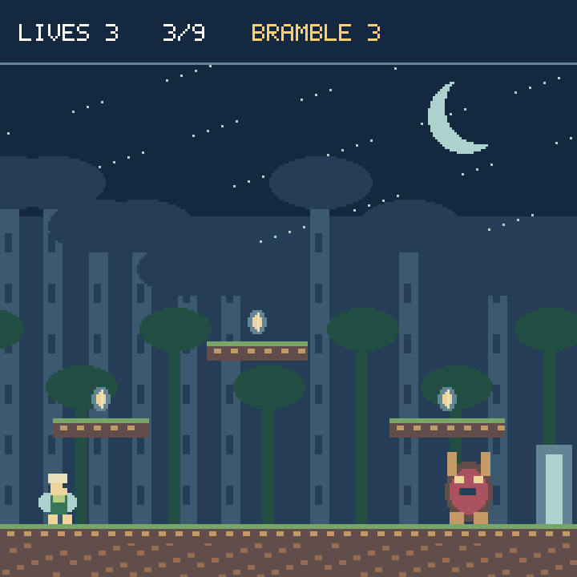
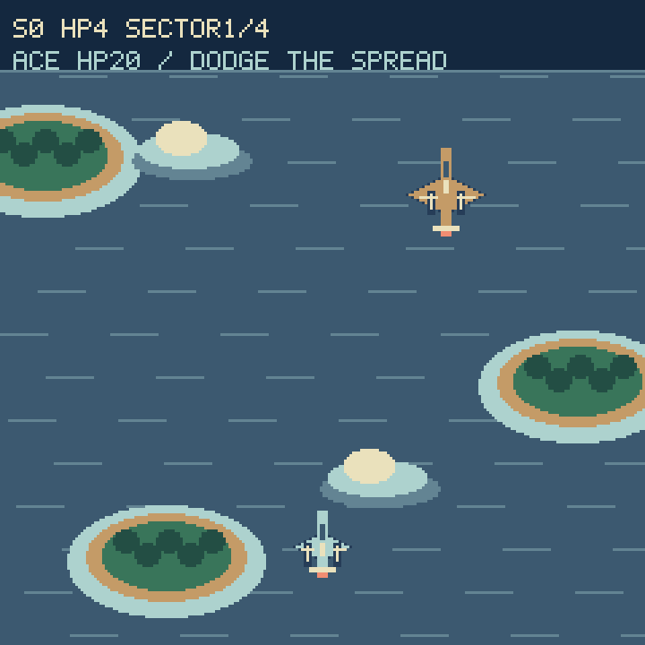
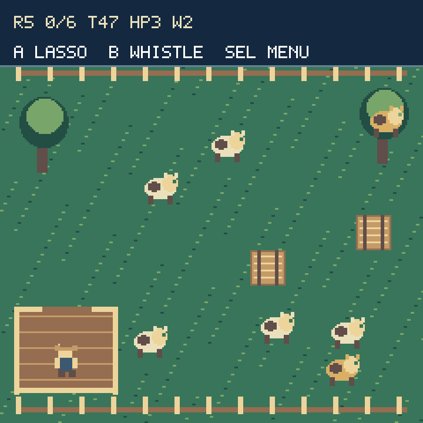

# Arcade polish

These previews render the games' real pixel scenery and sprites at 3× scale.
Text approximates CircuitPython's terminal font; they are not device photos.

## Sprite's Journey



Nine rooms now have visible exit gates, collectible spark routes, layered
moonlit scenery, an animated 16×22 hero, and guardians whose drawings match their
collision bounds. Collect every spark and defeat the guardian to open the gate.

- Left/Right moves; A jumps. Short jump buffering and ledge grace make inputs
  forgiving. From room four, hold A while falling to glide.
- Hold B for ranged magic. Three player projectiles and three guardian thorns
  are pooled; firing does not allocate bitmaps.
- Guardians flash before throwing thorns. Jump over them and return fire.
- Each room starts with three hearts. A hit returns you to the entrance with
  brief invulnerability and retains that room's collected sparks. Losing all
  hearts costs a life and retries the room. Guardian victories restore one life,
  up to five. Losing all lives restarts the nine-room journey.
- SEL pauses. Up + Down exits, including at title/intermission prompts.

## Aerial Dog Fight



Four sectors lead to a 20-HP ace that stays in the arena until defeated.
Coastal scenery stays fixed while aircraft and projectiles move above it.

- D-pad flies. Hold A to fire. Hold B for faster movement while fuel remains;
  fuel recharges when unused. Diagonal speed is normalized.
- Start with twin cannons, a rapid cannon, or armored twins (+2 hull,
  but slower normal flight and boost).
- Between sectors, select twin cannons, a rapid cannon, or repair two hull
  (maximum six). Fuel refills and hostile projectiles clear at these breaks.
- Twin cannons fire two shots every 0.24 seconds; the rapid cannon fires one
  every 0.13 seconds. Later raiders take two hits. The ace uses a three-shot fan.
- Hits grant 1.1 seconds of protection, preventing a single collision pileup
  from draining all hull. SEL pauses simulation clocks; Up + Down exits.
- Defeat the ace to win. Escaping ordinary raiders yields no score; the ace
  cannot scroll offscreen and accidentally trigger victory.

## Loose Cows



The ranch now has textured grass, fences, a visible corral gate, illustrated
hay bales, an animated rancher and herd, and cream/gold cows. A visible lasso
marks the tethered cow. Gold cows award double points.

- D-pad moves. A lassos a nearby cow; bring it into the lower-left corral.
  Press A again to release it. B whistles loose cows toward you.
- Whistles use collision-checked movement, so they cannot push cows through
  hay or outside the fences. Cows spawn in open space without overlapping.
- Consecutive deliveries within four seconds build a multiplier up to ×5.
- Quotas rise to six, with up to seven cows and five bales. Deadlines account
  for the quota and never fall below 28 seconds; three lives permit retries.
- Every three cleared rounds, choose longer rope, an extra whistle, or faster
  boots. Bonuses last for the run. Lives and whistle stock remain in the HUD.
- SEL pauses the timer and combo window. Up + Down exits; best scores persist
  when writable. Filesystem read-only behavior remains the shared score helper's.

## Installation and rendering

Copy `Firmware/Games/KeyBoyArcade.py` and `GameMenu.py` to `/lib`, and update:

| Repository source | KeyBoy location |
| --- | --- |
| `Sprites_Journey/Sprites_Journey.py` | `/lib/Sprites_Journey/Sprites_Journey.py` |
| `Aerial Dog Fight/AerialDogFight.py` | `/lib/AerialDogFight.py` |
| `Loose_Cows/Loose_Cows.py` | `/lib/Loose_Cows/Loose_Cows.py` |
| `Firmware/code.py` | `/code.py` |

Keep existing package `__init__.py` files. No image files are needed for these
three games. Existing high-score paths remain unchanged. The launcher releases
the shared arcade art module when returning to its menu.

One reusable scenery buffer consists of fifteen 240×16 4-bit strips (1,920
bytes each). It is repainted only between rooms/rounds; normal movement changes
sprite positions. Dog Fight retains seven enemy slots and 28 projectile slots.
Pause panels retain their backing and labels across openings. The CircuitPython
driver still controls dirty-region merging; these are allocation/rendering
properties, not measured bandwidth or frame-rate claims.

## Verification

```sh
python3 -m unittest discover -s tests -p test_arcade.py -q
python3 tools/preview_arcade.py
```

Twelve host tests cover all nine Sprite's Journey rooms using legal controller
inputs, full four-sector/ace completions with both Dog Fight weapons and legal
repair choices, invulnerability, fuel recovery, pool retention with bitmap
allocation prohibited, fifteen ranch layouts, a controller-driven herding
round, collision-safe whistles, and cached pause panels. Native board checks
passed on the connected ESP32-S3 running CircuitPython 9.0.0-beta.2 with real
launcher and audio allocations resident:

- All nine rooms completed using controller inputs, with every spark and guardian.
- Twelve consecutive cached pause openings passed; 87,792 bytes free afterward.
- Both Dog Fight loadouts completed four sectors and defeated the ace, ending
  with three/two hull and 4,500 points. Collected heap was 79,728–79,824 bytes.
- Nine ranch layouts, both animation frames, and collision-safe whistles passed;
  collected heap stayed at least 94,976 bytes free.

The installed modules and launcher match the repository. All existing save and
score files were byte-preserved, and the launcher restarted. These automated
checks verify completion paths and runtime compatibility; they are not an SPI
benchmark or a substitute for subjective play-feel feedback.
