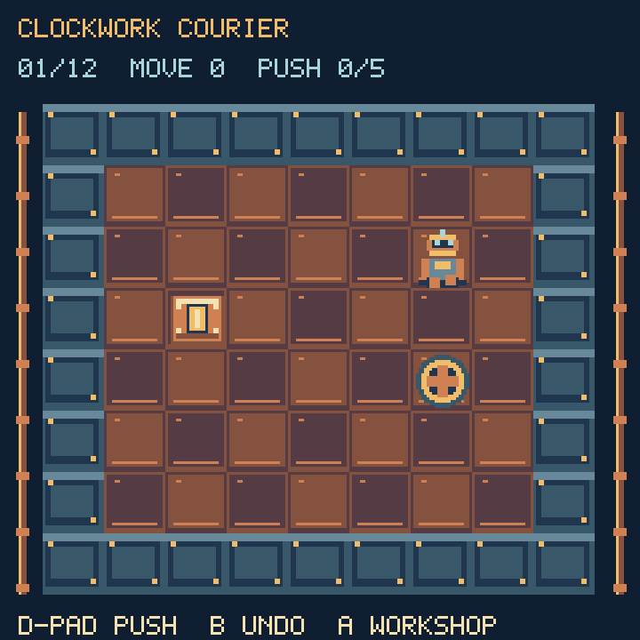
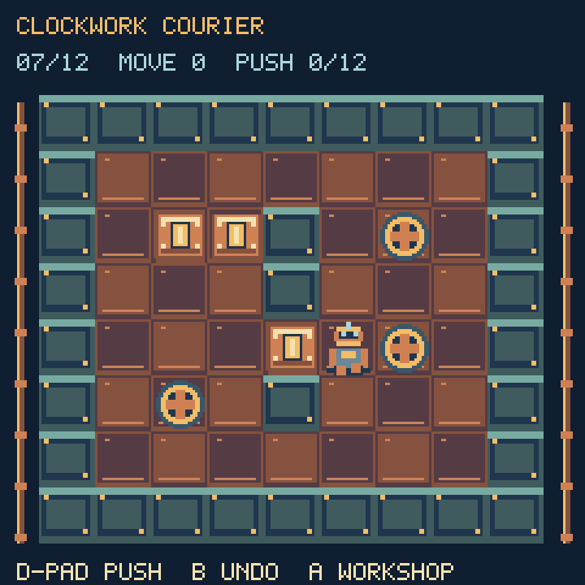

# Clockwork Courier




A quiet puzzle game for the gaps between KeyBoy's action adventures. Guide a
brass delivery robot through twelve workshops, pushing power cells onto glowing
docks. Every room has a verified solution; undo and restart make mistakes
recoverable without lives or a timer.

- D-pad walks and pushes. Cells cannot be pulled or pushed through other cells.
- B undoes a move, including a push. The last 128 moves are retained.
- A or SEL opens the workshop: resume, restart, room selection, save, or leave.
- Up + Down returns to KeyBoy.
- Completing a room unlocks the next. Replay completed rooms for bronze,
  silver, or gold: gold meets the displayed push target; silver allows three
  extra pushes. All twelve golds earn 36 medal points.

Four workshop palettes, riveted walls, copper pipework, a two-frame robot,
and illuminated cells/docks are drawn from small native pixel sprites. Moving
and undoing update existing actors and HUD labels. The terrain strips and menu
panels remain allocated; a new room repaints the same terrain buffers.

Progress and best move/push records save to `/clockwork.sav` after a delivery,
or through Save progress. A save restores completed rooms and records, not an
unfinished room. Read-only USB mode reports a failed save without losing the
current session's progress. Existing games' save files are not touched.

## Install and verify

Copy `Firmware/Games/ClockworkCourier.py` and `Firmware/Games/KeyBoyScenes.py`
to `/lib/`, together with the updated `KeyBoyLauncher.py` and `/code.py`.
No external image assets are required.

```sh
python3 -m unittest discover -s tests -q
python3 tools/preview_new_games.py
```

Seven dedicated host tests cover legal completion of all twelve rooms, gold
scores, full undo restoration, bounded history, invalid moves, retained bitmap
allocations, and transactional save loading. The screenshots use actual game
art with desktop text approximating the device font.

## Connected hardware

On the ESP32-S3 running CircuitPython 9.0.0-beta.2, all twelve rooms completed
with legal moves and earned gold. Reversing each solution restored its initial
position and move/push counts. Fifteen repeated cached-menu openings also
passed. The test replaced the save method so synthetic completions could not
change player progress; all existing save files were compared byte-for-byte.
