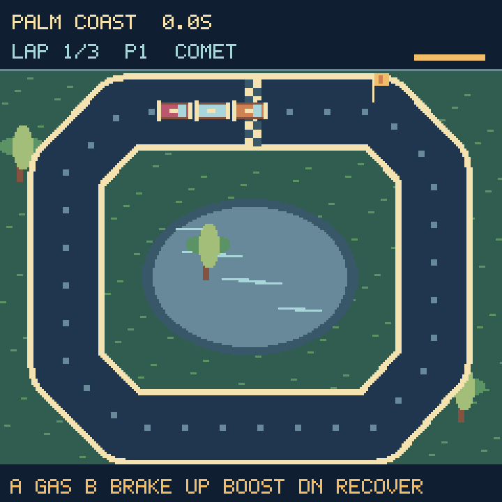
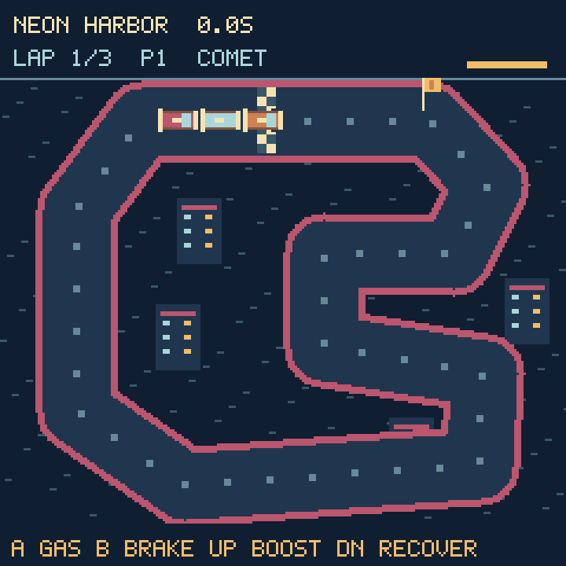

# Drift Circuit




KeyBoy's first racing game adds short, replayable skill runs to the library.
Race three laps around Palm Coast, Copper Canyon, or Neon Harbor. Each course
has distinct scenery and corner geometry. Ordered yellow checkpoints guide
you around the circuit and prevent finish-line shortcuts from counting as laps.

Choose a car in the garage:

| Car | Driving style |
| --- | --- |
| Comet | Balanced speed and grip |
| Needle | Sharp handling and acceleration, lower top speed |
| Bulwark | Fast straights, wider slides and earlier braking |

- A accelerates; Left/Right steer relative to the car's heading.
- B brakes. Braking into a turn loosens traction and replenishes boost faster.
- Up spends rechargeable boost; off-road surfaces limit speed and disable boost.
- Down recovers to the last checkpoint for a two-second penalty. Rivals advance
  by the same two seconds, and checkpoint/lap progress is preserved.
- SEL pauses every race clock and opens resume/restart/help/save/garage options.
- Up + Down returns to KeyBoy.

Two non-contact pace rivals provide a target. Championship finishes award
5/3/1 points by place, across all three circuits. Retry a circuit before
accepting its result; retries cannot duplicate points. Earn gold at 13 points,
silver at 9, or bronze for completing the cup. Every car can finish every course.

Time trials offer independent records and gold targets of 26/40/35 seconds.
Silver allows 30% extra time; any other finish earns bronze. Races have a
120-second active-time limit, with retries available. The opening countdown
and pause menus consume no race time.

Sixteen-direction car sprites, colored rivals, skid marks, a checkpoint flag,
and a boost meter move over retained scenery. Small banks and 1,920-byte
terrain strips avoid large bitmap allocations. Normal racing never allocates
a new bitmap or rebuilds the whole scene; track changes repaint existing
terrain buffers. Retrying the same course reuses its painted scenery,
and a scanline road renderer avoids repeatedly drawing overlapping pixels.

Best times, garage selection and cup records save to `/drift_circuit.sav`.
Finishes autosave; the pit menu also offers Save records. Read-only USB mode
reports unavailable saving while retaining records in the current session.

## Install and verify

Copy `Firmware/Games/DriftCircuit.py` and `Firmware/Games/KeyBoyScenes.py`
to `/lib/`, with the updated `KeyBoyLauncher.py` and `/code.py`.

```sh
python3 -m unittest discover -s tests -q
python3 tools/preview_new_games.py
```

Thirteen dedicated host tests cover all nine car/course combinations using legal
controller inputs, gold targets, checkpoint order, countdown/timeout, pause-clock isolation, recovery,
off-road speed, finite boost, retained bitmaps, save records, malformed data,
championship retries, and cached track retries. The screenshots render actual game art; desktop
text approximates the device font.
