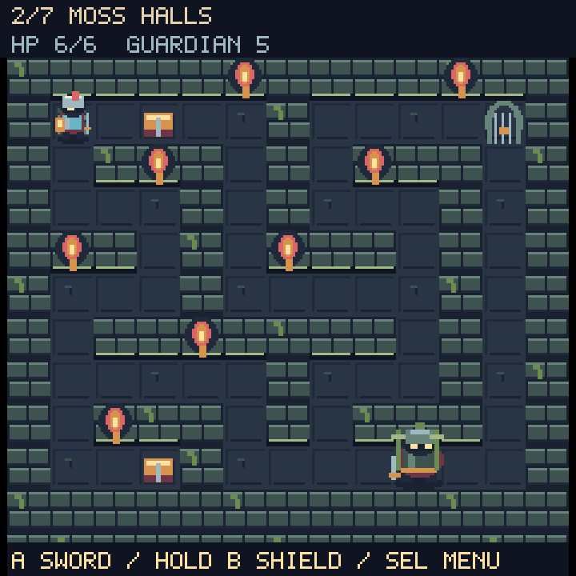
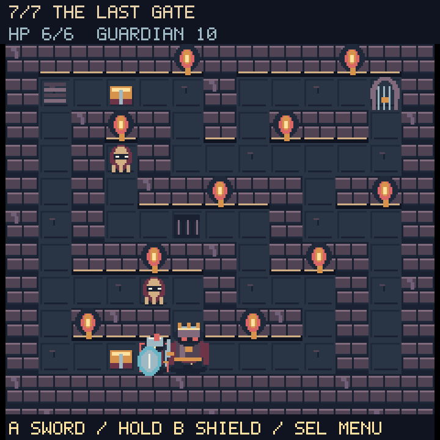

# Dungeons: Can You Leave?





Seven themed dungeons with larger armored characters, distinct guardians,
beveled stonework, animated torches, supply chests, warning runes, and a glowing
exit. These previews render the game's actual bitmap code at 3× nearest-neighbor
scale. Desktop text approximates CircuitPython's `terminalio` font.

## Controls and combat

- D-pad: walk. Movement interpolates between tiles with directional animation.
- A: strike adjacent enemies. Release and press again for another swing.
- Hold B: guard. Enemy blows are blocked; walking and sword attacks become
  slower, and guarded strikes deal one damage instead of two.
- SEL: resume, retry this floor, save the best floor cleared, or leave.
- Up + Down: exit, including from menus and the welcome screen.

Guardians and shades mark the tile they intend to attack. Step off the mark
or guard through the blow, then strike during recovery. Enemies move one
cardinal tile at a time and cannot walk through walls or overlap the player.
Sword cooldowns prevent repeated button presses from skipping combat timing.

Spikes spend 1.8 seconds safe, 0.7 seconds warning, then 0.7 seconds active.
Shields do not block spikes. Supply chests restore two hearts and remain
available if you walk over them at full health. Each new floor restores two
hearts, up to six. Dying offers a full-health retry of the current floor.
The last guardian opens the final escape gate; you can leave or play again.

## Level repairs and completion checks

Moss Halls (floor 2) and Thorn Keep (floor 5) had a wall at `(8, 9)` separating
the start from the guardian. Both corridors are now connected. Side passages
on floors 4, 6, and 7 are also connected before the exit opens, including the
previously isolated shade in Iron Depths.

Every walkable tile, guardian, shade, supply cache, and trap is reachable from
the start with the exit still locked. Each exit is reachable after its guardian
falls. Automated completion runs use the real movement, attack, enemy AI,
shield, trap timing, and gate logic. They clear all seven floors at six hearts
without teleporting, editing enemy health, or enabling invulnerability.

| Floor | Theme | Preview |
| --- | --- | --- |
| 1 | Cellar / Gate Warden | [View](floor-1.png) |
| 2 | Moss Halls / Moss Golem | [View](floor-2.png) |
| 3 | Ember Vault / Cinder Knight | [View](floor-3.png) |
| 4 | Shade Maze / Veil Reaper | [View](floor-4.png) |
| 5 | Thorn Keep / Thorn Sentinel | [View](floor-5.png) |
| 6 | Iron Depths / Iron Colossus | [View](floor-6.png) |
| 7 | The Last Gate / Oathbreaker | [View](floor-7.png) |

## Rendering and persistence

Each floor uses twelve static 234×18, 4-bit terrain strips. Hero, guardian,
props, torches, effects, and enemies use retained sprite atlases. The largest
bitmap is 2,268 bytes. Normal play allocates no new bitmaps and never repaints
terrain. Defeating a guardian swaps the gate's atlas index. Menus reuse their
panel and labels; pause time is excluded from enemy/trap timers. A new floor
or explicit retry rebuilds the scene. Actual dirty-region merging and SPI
transfers remain controlled by the display driver.

`/dungeons.txt` retains the existing single-number best-floor format. Best
progress is saved after each cleared floor or from SEL, using a temporary file
and rename. USB read-only/full-disk failures are reported. This is a best-score
record, not a saved mid-dungeon run. The existing high score is preserved during
deployment and automated board testing.

Copy `Firmware/Games/Dungeons Can You Leave/Dungeons_CYL.py` to
`/lib/Dungeons_CYL.py`. No image files or additional libraries are required.

## Verification

```sh
python3 tests/test_dungeons.py
python3 tools/preview_dungeons.py
```

Eighteen host tests cover every map's connectivity and playable completion,
gate locking, combat timing/range, windup/guard/dodge behavior, enemy pathfinding,
spikes, healing/retries, retained bitmaps, small art allocations, high-score
compatibility, menu input edges, pause timing, same-floor retry, and the full
campaign/finale loop. Syntax/whitespace checks pass, along with 65 regression tests across Lantern
Acre, Wildspark, and Last Beacon.

### Connected ESP32-S3 (2026-09-25)

The real CircuitPython 9.0.0-beta.2 board completed all seven floors twice with
the launcher, display, and audio resident. Every floor finished at six hearts,
using actual combat/timers/movement and menu overlays. Terrain builds took
3.64–3.97 seconds. Collected free heap ranged from 65,744 to 67,168 bytes;
each floor's free-memory value matched exactly in the second campaign.
Read-only saving correctly returned failure.

The installed module matches the source, `/dungeons.txt` is byte-for-byte
unchanged, and the launcher restarted successfully. These are automated
hardware completion/stress checks, not a measured frame rate or hands-on
balance test. Successful writable-mode saves remain untested while USB owns
the board filesystem.
