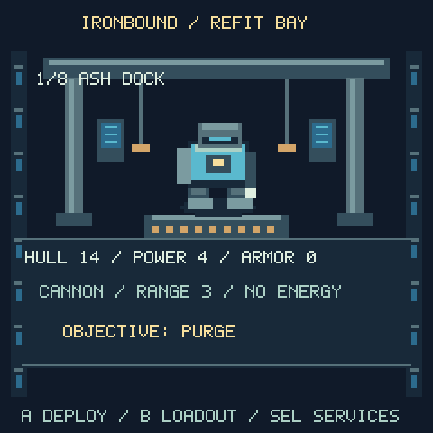
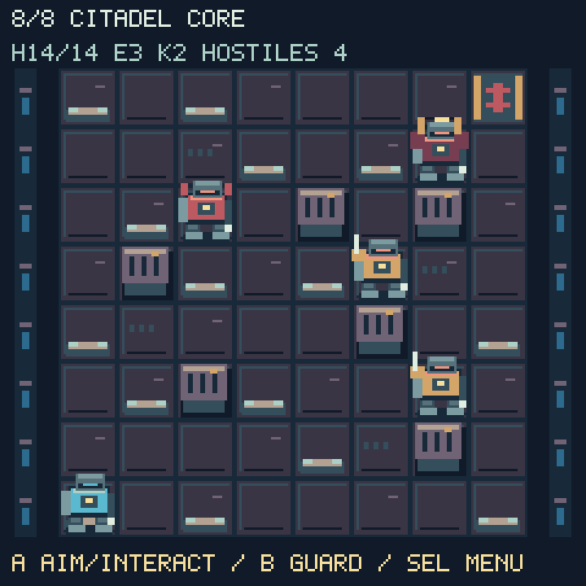
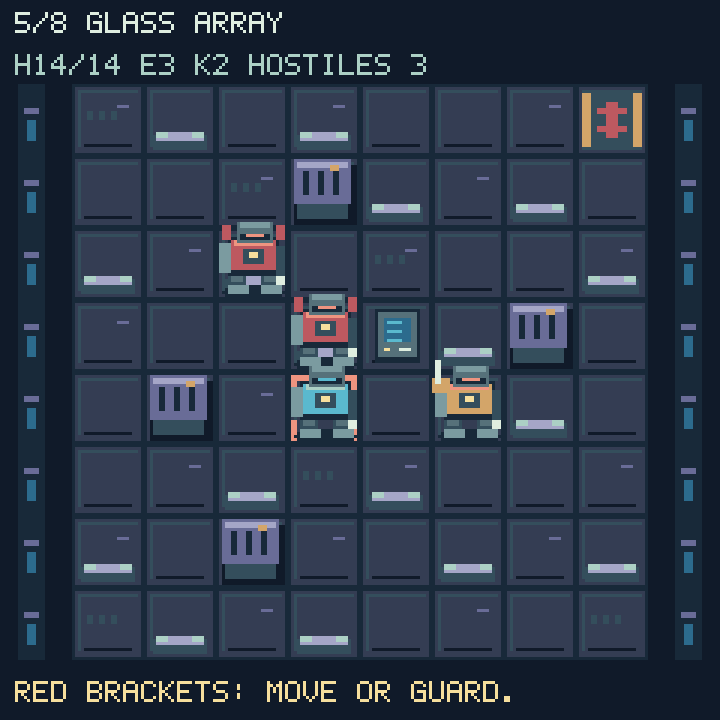

# Ironbound





Eight turn-based mech operations, with a refit bay, two weapon loadouts,
visible enemy attack targets, relay and salvage objectives, and permanent
upgrade choices. The previews render the game's actual bitmap code at 3×
nearest-neighbor scale; desktop text approximates `terminalio`.

## Controls

| Location | Controls |
| --- | --- |
| Refit bay | A deploys; B chooses cannon or rail; SEL saves or leaves. |
| Battlefield | D-pad moves one tile; A interacts with a nearby relay or enters targeting; B guards for one turn. |
| Targeting | D-pad cycles targets; A fires; B/SEL cancels without spending a turn. |
| Pause | SEL opens Resume, Mech systems, Save checkpoint, or Leave. |
| Systems | Repair kit, EMP pulse, mission briefing, or Back. |
| Anywhere | Up + Down exits. |

One successful movement, shot, guard, repair, pulse, or relay interaction uses
one turn. Invalid moves/shots, canceled targeting, and menus cost no turns.
Simultaneous inputs cannot move and attack for the price of one action.

## Tactical rules



Red brackets show the tile an enemy will fire at after your next action.
Moving away makes that shot miss. Enemies recover for a full turn after firing,
giving you a counterattack opportunity. Scouts fight at range 1, artillery at
range 4, and the commander at range 3. Enemy movement is cardinal and uses
pathfinding; solid machinery blocks movement and shots, including diagonal
shots through blocked corners. Enemies cannot overlap each other or the player.

- Cannon: range 3, no energy cost.
- Rail: range 5, two extra damage, costs one energy. At zero energy it falls
  back to the free range-3 cannon.
- Guard: reduces each incoming hit by three and recharges one energy, up to
  three. Armor and low cover reduce damage further.
- Repair: one of two kits restores up to seven hull; includes guard protection
  during the enemy response. A full-health repair wastes no kit or turn.
- EMP: costs three energy, deals five damage to all visible enemies within
  range 2, and includes guard protection. No targets means no cost or turn.

Dead enemies never retaliate. Shots are deterministic; there are no hidden
hit-chance rolls. Each deployment or retry restores full hull, energy, and two
repair kits. Losing returns you to the current mission's refit bay.

## Campaign

All operations require clearing the hostiles before the extraction pad opens.
Relay missions additionally require two A interactions on or beside the console;
salvage missions require walking over both cargo crates. Extraction is at the
upper-right corner. Enemy turns stop immediately on extraction.

| Mission | Operation | Additional objective |
| --- | --- | --- |
| 1 | [Ash Dock](mission-1.png) | Clear hostiles |
| 2 | [Signal Frost](mission-2.png) | Activate relay |
| 3 | [Broken Convoy](mission-3.png) | Recover two crates |
| 4 | [Red Foundry](mission-4.png) | Clear hostiles |
| 5 | [Glass Array](mission-5.png) | Activate relay |
| 6 | [Drowned Yard](mission-6.png) | Recover two crates |
| 7 | [Black Transmitter](mission-7.png) | Activate relay |
| 8 | [Citadel Core](mission-8.png) | Defeat commander and escort |

After each of the first seven missions, choose weapon power +1 (cap 12), hull
capacity +3 (cap 35), or armor +1 (cap 3). A capped choice does not consume the
reward; a fully upgraded legacy mech can still advance. The finale records
campaign completion and offers a new campaign or exit.

## Saves and rendering

`IB2` stores mission, hull, weapon power, armor, hull capacity, loadout, and
campaign completion at `/ironbound.sav`. Old four-field saves migrate in memory,
retaining mission and upgrades within the new stat caps. New base hull capacity
is at least 14. Checkpoints restart the current operation with fresh supplies;
they do not save individual enemy positions or partly collected objectives.
The pause menu states this explicitly. Cleared missions attempt an autosave;
manual saves are available in the bay and pause menu. Writes use a temporary
sibling and rename. USB read-only/full-disk failures are reported.

Static scenery uses twelve 240×16 4-bit strips; 24×28 mech atlases have two idle
frames. The bay displays an enlarged mech, gantry, work lights, and service
panels. The largest individual bitmap is 2,304 bytes. Turns update existing
actors, markers, gate/objective indices, and labels; they never repaint terrain
or allocate bitmaps. Menu panels/labels are cached. Scene changes occur between
the bay and missions. The display driver owns dirty-region merging and SPI
transfers; no measured frame rate is claimed.

Copy `Firmware/Games/Ironbound/Ironbound.py` into the existing package at
`/lib/Ironbound/Ironbound.py`. It uses the updated shared audio engine and sound
folder documented in [KeyBoy audio](../audio/README.md).

## Verification

```sh
python3 tests/test_ironbound.py
python3 tools/preview_ironbound.py
```

Twenty-six host tests pass. A legal-action solver completes all eight missions
with both weapons and all three refit paths: 48 successful mission runs, without
teleporting, editing enemy health, or bypassing objective rules. Tests also cover
every walkable tile's reachability, line of sight, enemy plans/recovery,
turn/resource costs, objectives/extraction, save migration, refit caps,
retained bitmaps, menu/targeting input, and the complete campaign/finale loop.
The complete host suite passes all 117 tests. Syntax and whitespace checks pass.

### Connected ESP32-S3 — 2026-09-26

With CircuitPython 9.0.0-beta.2, the real launcher/display and new streaming
audio engine resident, the board completed all eight missions with the cannon
and again with the rail: 16 successful operations. The test exercised the bay,
mission scenes, pause overlays, legal combat actions, every objective, refits,
and extraction. Runs finished with 12–14 hull and no mission failures.

Each bay-plus-field construction pair took 8.28–8.97 seconds; this includes two
full scene transitions, not turn latency. Collected free heap ranged from
66,288 to 69,232 bytes across the runs. Existing mission-8 legacy progress
loaded correctly and read-only saving returned failure. The installed module
matches the source, the original save remained byte-for-byte unchanged, and
the launcher restarted. These are automated hardware completion/stress checks;
hands-on balance feedback and writable-mode save testing remain separate.
