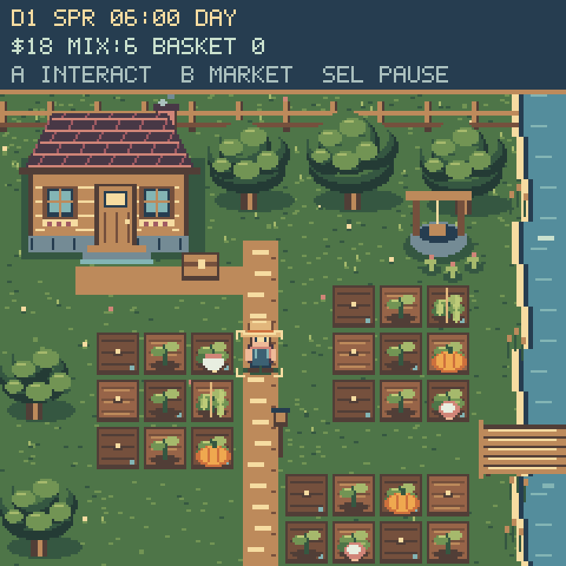
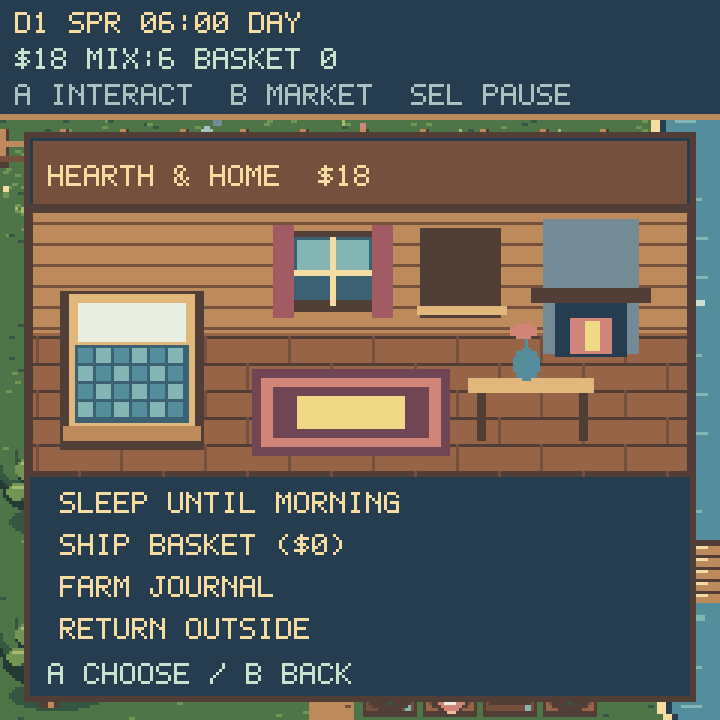
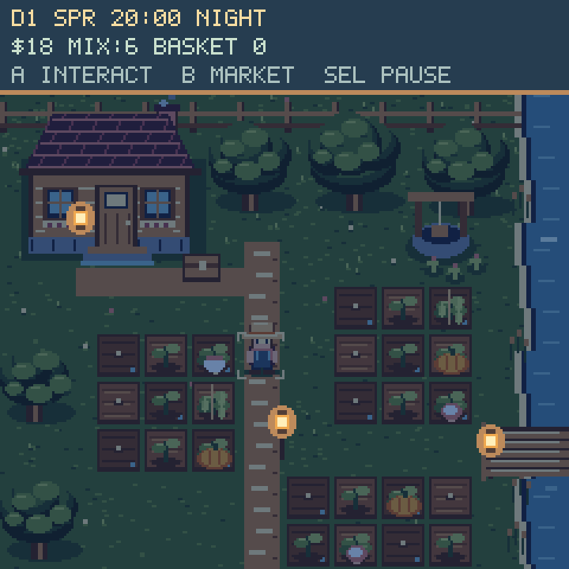
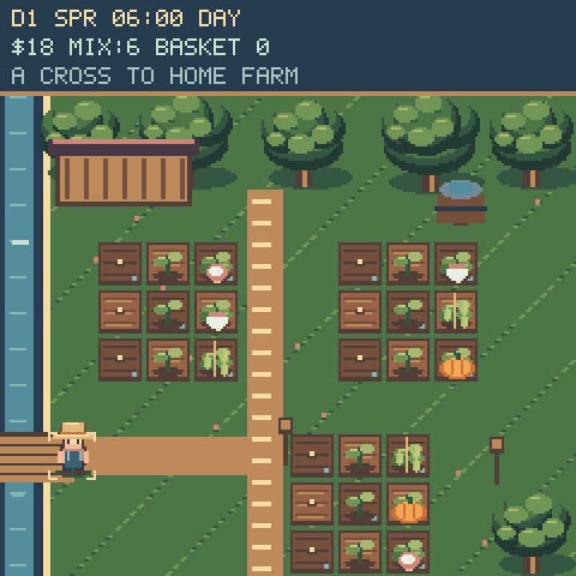
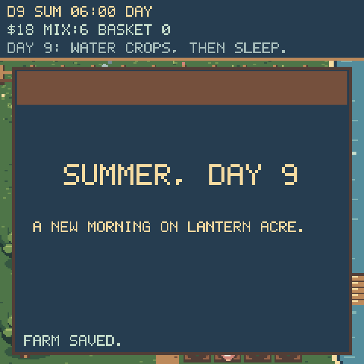
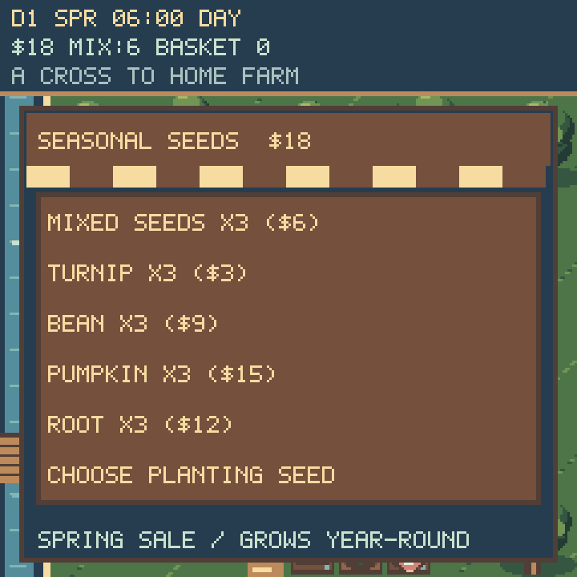

# Lantern Acre











These 3× nearest-neighbor previews render the game's actual bitmap and sprite
code. Desktop text approximates `terminalio`; hardware uses CircuitPython's
font. The farm preview stages all crops and unlocks all plots to show the art.
A new farm starts with one plot, six seeds, and $18. Previews are development
artifacts and do not need to be copied onto KeyBoy.

## Controls and pacing

- D-pad: walk. The corner marks show the tile affected by A.
- A: plant, water, or harvest. At the front door, enter the cottage.
- B: open the market from anywhere; close a menu.
- SEL: pause, save, or leave. Up + Down exits without saving.
- Cottage: sleep until morning, ship crops, or view the farm journal.
- Porch chest: ship crops. Herbs by the well: collect $2 once per day.
- East footbridge: A enters Lantern Meadow. A at the meadow's west bridge
  returns home. The market remains available with B in either area.
- Market → Seed shop: buy mixed or named packets; **Choose planting seed**
  selects which stock A will plant. Buying a named packet also selects it.

Each day is four active minutes, starting at 06:00. Dusk begins at 17:00;
night begins at 75% of the day. Time stops inside menus. Sleeping skips to
morning, attempts a save, and displays the full **Season, Day X** card for
1.8 seconds. The day count matches the farm HUD; a failed save is shown on the
card. Card/menu time does not advance the day. If unwatered crops remain, sleep asks for a
second A press. Watered crops gain one growth stage each morning; dry crops
wait rather than die. Existing plants retain their crop type across seasons.

| Crop | Watered nights | Sale price |
| --- | --- | --- |
| Turnip | 2 | $5 |
| Bean | 3 | $8 |
| Pumpkin | 4 | $13 |
| Root | 3 | $10 |

Mixed seeds become the current season's crop and still cost $6 for three.
Specific packets plant their named crop in **any season**, letting you choose
what to grow. Each crop's normal season discounts each seed by $1:

| Packet (3 seeds) | Normal price | Seasonal price |
| --- | --- | --- |
| Turnip | $6 | $3 in spring |
| Bean | $9 | $6 in summer |
| Pumpkin | $15 | $12 in autumn |
| Root | $12 | $9 in winter |

The HUD shows the selected seed stock. An empty selected packet does not
silently consume mixed seeds; choose another stock or buy more. Existing crops
keep their type, growth, and watering across seasons and area changes.

The home farm retains its original 26 planting spaces. Lantern Meadow adds
27 more across three 3×3 plots, for 53 spaces across six plots. The first home
plot is available immediately; further plots cost $40, $100, $140, $180, and
$220 in order. The final three purchases unlock the meadow plots. All crops
in both areas grow together at dawn. The copper can waters the current tile
and its left/right neighbors; the cart adds $1 per harvested item.



## Rendering and verification

Ten 240×20 4-bit terrain strips, a shared crop atlas, a 12-frame 18×24 farmer
atlas, and persistent HUD labels form each area. Only the current area's
terrain and plot sprites are resident. Crossing a bridge repaints the same terrain buffers for the other area
while keeping crop/farmer atlases and all cached menu art; ordinary movement
and tending do not rebuild either scene.
Crops change sprite banks and atlas indices, movement changes TileGrid positions, and small
creek/smoke sprites update at 3 Hz. Menus push/pop their own overlay without
removing the farm. Interior strips and reusable panel backings/labels are
prepared at farm startup. Opening the market, pause menu, or cottage never
allocates a new bitmap. The seed pages and morning card reuse that same
overlay and labels, including when navigating nested seed-selection menus. Shared panel atlas strips are 2,128 bytes each; the
largest terrain strip is 2,400 bytes. Terrain and interior use tailored
16-color palettes; panel backings use 2 bits/pixel and the HUD uses 1 bit/pixel.
Crops and the farmer retain their separate 32-color palette.

World palette changes at dusk, night and dawn invalidate world colors once;
normal play never clears the screen or repaints the terrain. These lighting
transitions can require a broad display refresh, unlike normal local updates.
The CircuitPython display driver owns dirty-region merging and SPI transfers.

Run from the repository root:

```sh
python3 tests/test_lantern_acre.py
python3 tools/preview_lantern_acre.py
```

Host tests cover growth/pacing, crop-specific sales, upgrades, map reachability,
atlas bounds, old saves, rejected saves, scene/bitmap retention, walking input,
menu input edges, buffered actions and sleep confirmation. Host display doubles cannot measure
SPI bandwidth or frame rate; a hands-on board playtest remains useful.

Save format `LA4` retains the earlier farm state plus current area, all six
plot unlocks, four packet stocks, and the selected planting seed. Meadow plants
use a separate coordinate range in the same crop store. LA2 and legacy 8-field
saves migrate without changing the original crops, day, money, or upgrades.
Old saves begin in the home area with mixed seeds selected. New saves write a temporary sibling before renaming over the
save. Failed writes are reported; save-and-leave stays in the menu on failure.

## Connected-device validation (2026-09-25)

Tested the menu-memory fix on the connected ESP32-S3 running CircuitPython
9.0.0-beta.2 with actual launcher/menu/audio allocations resident. The farm and
all reusable panels initialize in about 7.18 seconds. Ninety successive
cottage/market/pause openings passed with changing inventory/HUD text and
small live allocations deliberately fragmenting the heap. Memory stabilized
around 38,464 bytes free during stress; 44,352 bytes remained after releasing
the artificial fragments. These are stress snapshots, not frame-rate metrics.

The updated module is installed, the existing farm save is byte-for-byte
unchanged, and the launcher was restarted. Seventeen host tests pass,
including bitmap-allocation rejection during repeated menu opening and
bounded backing allocations. Syntax and whitespace checks pass. The earlier
smoke also verified day-72 legacy data, dawn/lighting/crop updates, animation,
and read-only save failure. Successful hardware writes remain untested while
USB programming mode owns the filesystem.

## Expansion validation (2026-09-26)

Twenty-four Lantern host tests pass, including both areas' reachability,
crop growth across areas, repeated scene transitions with shared atlas/menu
identity, seasonal pricing and selected-stock consumption, LA4 roundtrips,
nested seed-page input, and the morning card under a no-bitmap-allocation
check. A separate regression asserts terrain-buffer identity across crossings.

On the connected ESP32-S3 with real launcher/audio allocations, twelve bridge
crossings, sixty menu openings and four morning cards passed. Memory ranged
from 36,336 to 41,904 bytes free after collection; area builds took 2.94–3.48s.
This stress uncovered fragmentation when replacing terrain buffers; both areas
now reuse one set of strips. Installed source matches the repository, the
existing save is byte-for-byte unchanged, and the launcher restarted.

## Loading-memory fix (2026-09-26)

The launcher now releases its display objects and module before importing a
game. Crop art is stored in 1,600-byte banks and farmer animation in 1,344-byte
banks, replacing the old 13,600/5,184-byte contiguous bitmaps. All farm bitmap
allocations are now at most 2,400 bytes, enforced by a host build test. Banks
retain the original artwork and are reused across animation, tending and area
changes. The earlier LA3 format retained save data. See the
[launcher validation notes](../launcher/README.md).

Days now last 240 active seconds. LA2/LA3 saves migrate to LA4 with the same
in-game time of day; existing crops, inventory, and progress are preserved.
