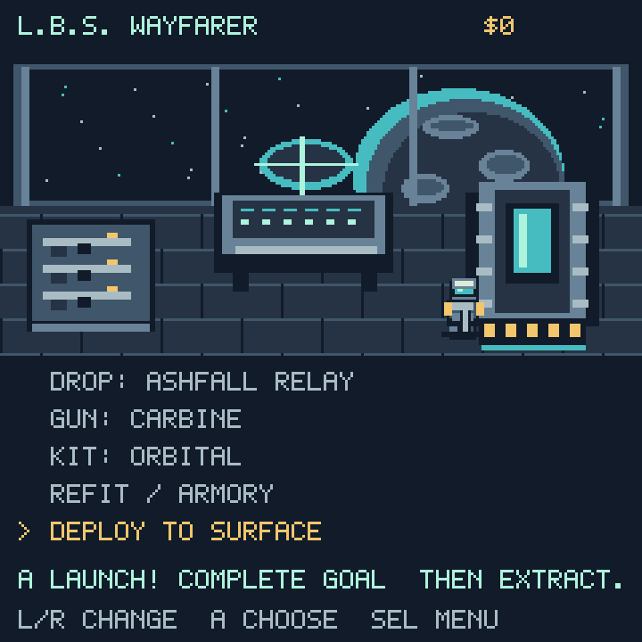
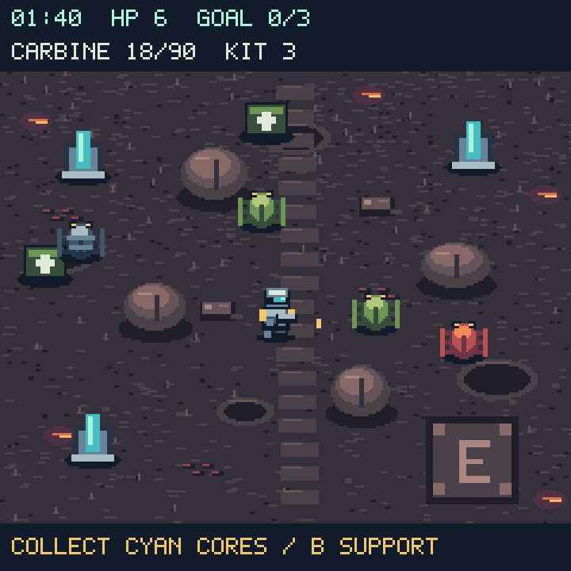
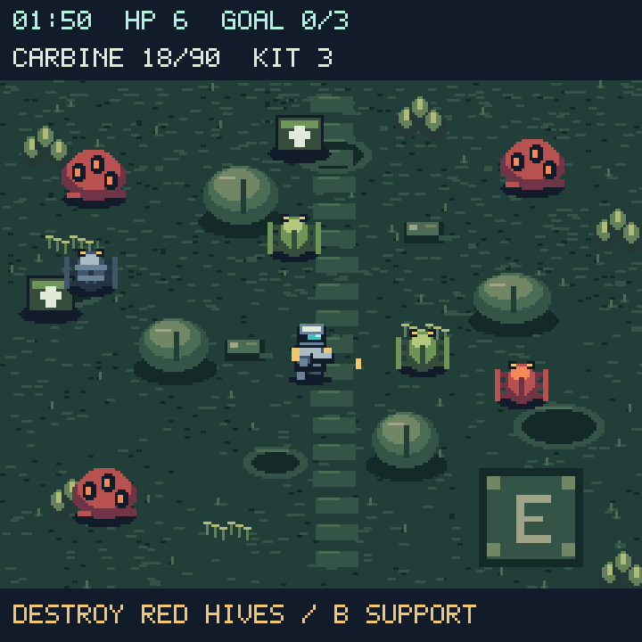
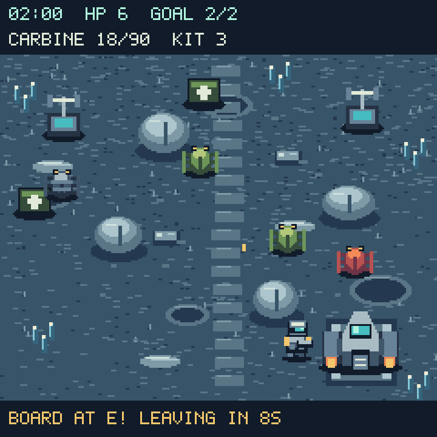

# Last Beacon









Previews use the game's actual scene builders at 3× nearest-neighbor scale.
Desktop text approximates `terminalio`. Actors are staged to show the artwork;
these are development previews, not photographs of the device. No image files
need to be deployed.

## Ship and controls

Start aboard the **L.B.S. Wayfarer**. Up/Down chooses a row. Left/Right changes
the contract, primary weapon, or support kit; A cycles the selected choice.
Select **Deploy to Surface** and press A to launch. All contracts and loadouts
are available immediately. Cleared contracts remain replayable for credits.

**Refit / Armory** buys armor (+2 maximum HP per level) or weapon power
(+1 damage per projectile per level), up to three levels each. **SEL** opens
ship services to save your career, view controls, or leave.

In the field:

- D-pad moves and aims, including diagonals. Rocks block movement and bullets.
- Hold A to fire. Facing locks while firing, so you can strafe and retreat.
  Release A and move to turn. Aim assistance selects nearby targets ahead.
- Empty magazines reload automatically. When both magazine and reserve are
  empty, an unlimited, weaker sidearm keeps you in the fight.
- B deploys the selected support kit. An eight-second cooldown prevents waste.
- Walk onto supply crates to regain three HP and ammunition. A crate remains
  available if both resources are full.
- SEL pauses the operation; menus freeze mission, reload and extraction clocks.
- Up + Down leaves the game. In-field abort returns to the ship without rewards.

| Weapon | Magazine / reserve | Behavior |
| --- | --- | --- |
| Carbine | 18 / 90 | Fast automatic fire, balanced damage |
| Scattergun | 6 / 36 | Three pellets, strongest at close range |
| Lancer | 6 / 30 | Heavy shots pierce two enemies |

| Support | Uses | Behavior |
| --- | --- | --- |
| Orbital | 3 | Marks a target ahead; 0.85-second warning, then area damage |
| Sentry | 2 | A tripod provides automatic covering fire for 14 seconds |
| Resupply | 2 | Restore three HP and three magazines' worth of reserve |

## Contracts and extraction

| Contract | Objective | Deadline | Base payment |
| --- | --- | --- | --- |
| Ashfall Relay | Collect 3 signal cores | 100 s | $45 |
| Bracken Front | Destroy 3 hives | 110 s | $60 |
| Frost Array | Transmit at 2 uplinks | 120 s | $65 |
| Cinder Wastes | Collect 4 signal cores | 100 s | $80 |
| Last Transmission | Transmit at 3 uplinks | 150 s | $100 |

Salvage cores are collected by proximity. Hives take weapon or orbital damage.
Uplinks need six seconds nearby; enemies close to the antenna contest the
transmission. Existing progress is retained when you step away.

After completing the objective, reach **E** at the lower right to call the
shuttle. Survive its **18-second approach**, then reach the landing pad during
the **12-second boarding window**. You can move away during the approach; the
shuttle does not wait indefinitely. The overall contract deadline keeps
running throughout extraction. Death, losing signal, or missing the shuttle
fails the drop. Every new drop starts with restored health and equipment.

Successful extraction earns base payment, $1 per ten seconds remaining, and a
$20 first-clear bonus. Failed/aborted drops grant no credits. Debrief returns
to the ship so you can change gear or retry.

## Rendering, saves and validation

The battlefield is 240×190, stored in ten static 4-bit bitmap strips to avoid
a large contiguous allocation on the ESP32-S3 heap. Trooper, three bug
types, objectives, supplies and shuttle share compact sprite atlases. Twelve
enemy slots and twenty projectile slots are allocated before the drop;
spawning, firing, hits, support effects and extraction update those same
TileGrids. Terrain is never repainted during combat. HUD text changes only
when its displayed value changes. Ship/field/debrief are scene transitions;
pause and refit use small overlays. Art uses 16 colors and menu backings use
1-bit bitmaps to fit alongside the launcher and I2S audio.

`LB2` saves contain selected contract/loadout, credits, clear flags and refits.
Old four-field saves migrate on load: campaign position and gun upgrades are
preserved, completed earlier drops become clear flags, and extra legacy
support charges convert to $20 each. A new drop restores health. Saving writes
a temporary sibling before replacing the existing save; debrief and ship
services report failures. USB programming mode keeps the filesystem read-only
from the game. In-progress missions are not saved.

From the repository root:

```sh
python3 tests/test_last_beacon.py
python3 tools/preview_last_beacon.py
```

The host suite exercises contracts, loadouts, extraction success/failure,
contested uplinks, projectile/cover collisions, reload and fallback behavior,
support, invulnerability, rewards, upgrades, map reachability, save migration,
menu input and retention of scene objects/bitmaps. The 25 checks pass. Host doubles do not model SPI refresh timing; connected-device
results follow.

## Connected-device validation (2026-09-25)

Tested on the connected ESP32-S3 with CircuitPython 9.0.0-beta.2, the actual
launcher resident, and real I2S audio. All five contracts passed the scripted
ship/drop/objective/shuttle/boarding smoke sequence. Ship, refit and field
pause overlays also passed. The original career save remained byte-for-byte
unchanged; its legacy mission, gun upgrades and support credit conversion
loaded correctly. Read-only save failure was reported correctly.

Initial ship/art setup took about 3.4 seconds, with a boarding message visible;
field builds took 1.06–1.10 seconds. After a busy combat test and garbage
collection, 90,272 bytes of heap remained free. Sixty busy simulation/render
updates took 2.78 seconds; this is a stress-test timing, not a guaranteed frame
rate or SPI bandwidth measurement. The main loop targets a 33ms total frame
budget and avoids adding a fixed delay when work already exceeds that budget.

The installed module matches the repository source, and the launcher was
restarted. All 25 Last Beacon tests, 15 Lantern Acre regression checks, host
syntax checks and whitespace checks passed. Hands-on weapon balance and
extraction playtesting, plus successful writable-mode saving, remain useful
follow-up checks.
