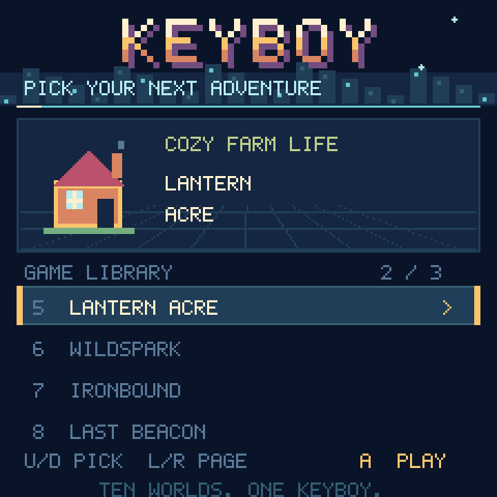
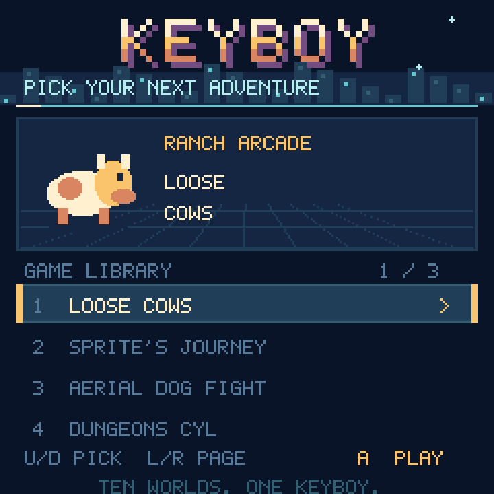
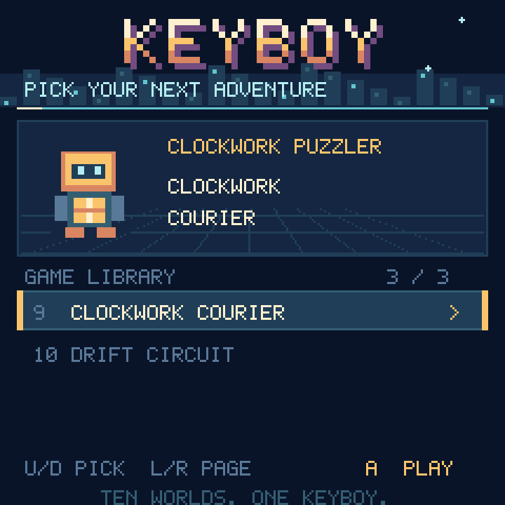

# KeyBoy arcade launcher







The start screen features a custom bevelled pixel logo, a night skyline,
twinkling stars, a moving light accent, and a floating emblem for each of the
ten games. The selected game's genre and title appear above the library.

- Up/Down selects a game, wrapping through all ten.
- Left/Right cycles three pages, keeping the same row where possible.
  The final page contains Clockwork Courier and Drift Circuit.
- A launches. Navigation and launch use distinct input handling; held buttons
  must be released after startup or returning from a game.
- The launcher remembers the last selection during the current session.
- Selection and launch use the existing navigation/confirmation sound cues.

All drawing is code-native. Fifteen small 4-bit strips hold the static scene;
idle animation only moves or hides existing sprites. Selection redraws the
48×48 emblem and updates existing labels. Navigation creates no new bitmaps.

## Loading games safely

The launcher is isolated in `KeyBoyLauncher.py`. Before importing a game,
`code.py` removes the menu, releases the launcher instance and module, and
collects garbage. Returning from a game builds a fresh menu. Decorative menu
art does not consume the game's heap.

Lantern Acre additionally divides its crop and farmer atlases into small
reusable banks. The old 13,600-byte crop bitmap and 5,184-byte farmer bitmap
are replaced by banks of 1,600 and 1,344 bytes. No farm bitmap allocation
exceeds 2,400 bytes. Crop changes and walking switch existing banks/indices;
the artwork, farm contents, and save format are unchanged.

## Installation and verification

Copy these together:

| Source | Device |
| --- | --- |
| `Firmware/Games/KeyBoyScenes.py` | `/lib/KeyBoyScenes.py` |
| `Firmware/Games/ClockworkCourier.py` | `/lib/ClockworkCourier.py` |
| `Firmware/Games/DriftCircuit.py` | `/lib/DriftCircuit.py` |
| `Firmware/code.py` | `/code.py` |
| `Firmware/Games/KeyBoyLauncher.py` | `/lib/KeyBoyLauncher.py` |
| `Firmware/Games/Lantern_Acre/Lantern_Acre.py` | `/lib/Lantern_Acre/Lantern_Acre.py` |

```sh
python3 -m unittest discover -s tests -q
python3 tools/preview_launcher.py
```

171 host checks pass, including launcher input edges/page navigation,
no-bitmap-allocation animation/selection, all farm sprite frames, and an
allocation cap enforced across the entire farm build. The images above render
the actual game art; desktop text approximates `terminalio`.

### Connected ESP32-S3 verification

The earlier farm memory verification below remains valid for its recorded
build. New-game checks are recorded in the two new game documents.

Eight actual menu-selection → launcher unload → farm load → game unload cycles
passed on CircuitPython 9.0.0-beta.2. Each farm load exercised every crop/farmer
frame, five menu pages, and both areas. Free heap after these operations stayed
between 67,600 and 67,792 bytes; after unloading the farm it returned to
155,696–155,888 bytes. No accumulating loss or allocation failure occurred.
The three installed sources match the repository, all existing saves/scores
are byte-for-byte unchanged, and the launcher restarted successfully.
