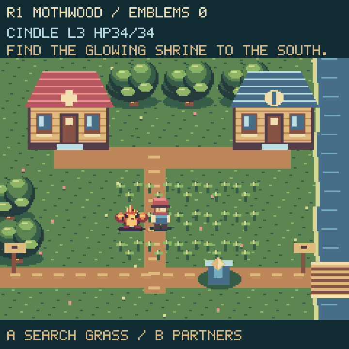
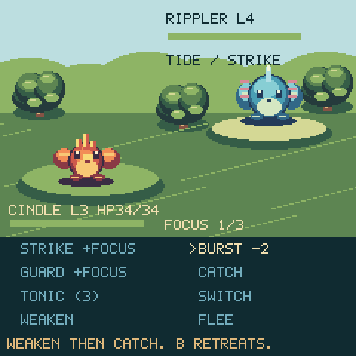
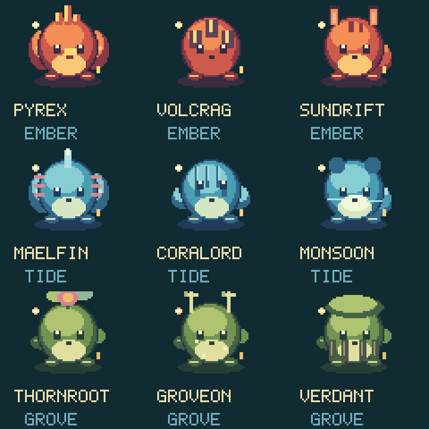

# Wildspark





A six-route creature adventure with a traveling companion, nine creature
families, 27 illustrated forms, three sanctuary emblems, and a rival finale.
These previews render the actual game bitmaps at 3× nearest-neighbor scale;
desktop text approximates the board's `terminalio` font.

## Playing

- D-pad: walk; navigate battle commands and menus.
- A: interact with a clinic, shrine, sanctuary or trail; search tall grass;
  confirm a battle action. Actions pressed during a step wait until arrival.
- B: choose your traveling partner; retreat from a battle; close a menu.
- SEL: pause, open the field guide, save, or leave. Battle pause offers controls
  and retreat. Up + Down exits without saving.

Choose Cindle (Ember), Bublet (Tide), or Buddy (Grove) when starting a new save.
Recover each route's glowing southern relic before taking the eastern trail.
Win sanctuary challenges on routes 2, 4, and 6 to earn emblems. All three
emblems unlock the rival at the sanctuary. The clinic restores every partner
and refills three tonics. Exploration continues after becoming champion.

Tall grass encounters follow six grass steps, with a grace period after
battle; A can deliberately search. Blocked movement does not count as a step.
Each captured family becomes a usable partner with its own level, HP, and XP.
Catching an already-owned family preserves that partner's progress.

## Battles

| Action | Effect |
| --- | --- |
| Strike | Reliable neutral damage; gain one focus, up to three. |
| Burst | Spend two focus on stronger elemental damage. |
| Guard | Gain one focus and reduce the next attack to one third. |
| Catch | Guaranteed recruitment at half HP or less; no consumable needed. Sanctuary/rival creatures cannot be caught. |
| Tonic | Restore up to 18 HP, consuming one of three clinic-refilled tonics. |
| Switch | Select another healthy companion. |
| Weaken | Gain focus and deal a safe hit that always leaves at least 1 HP. |
| Flee | Return to the trail (also available with B). |

Ember beats Grove, Grove beats Tide, and Tide beats Ember. Strong matchups
apply 1.5× damage; resisted attacks apply 0.75×. Enemies alternate a strike,
a charging turn, and a stronger burst. The intent above the enemy tells you
when to guard. Invalid actions consume neither resources nor turns. Switching
normally uses a turn, but replacing a fainted partner is free. If everyone
faints, the party recovers at full health. Retreating remains available.

Victories and successful catches grant XP to the active partner. Forms evolve
at levels 4 and 8; the level cap is 30. The field guide tracks discovered forms.

### Completing the field guide

Search grass with A, choose **Weaken**, then select **Catch READY** once the foe
has half HP or less. Weaken cannot knock out the foe, even with a high-level
partner. Successful catches join the party immediately. The guide shows your
count out of 27 and the trail numbers for each family.

Trails 1–3 offer first and middle forms. Trails 4–6 cycle through all three
forms of their three resident families: nine consecutive A searches per late
trail expose all nine local forms. Together those trails make every entry
catchable, including first forms after your team is fully evolved. Evolution
at levels 4 and 8 also records forms. Existing WS2 parties and guide flags
remain compatible.



Additional previews: [first forms](forms-1.png), [middle forms](forms-2.png),
[coastal trail](coast.png), [Moonglade](moonglade.png), and
[partner selection](partners.png).

## Rendering and saves

The 18×24 trainer has twelve directional walking frames; companions follow
behind. Battle creatures have two 48×48 breathing frames. Static scenery uses
small 4-bit bitmap strips. Walking moves existing sprites; battle idle updates
only frame indices. Route/battle transitions build new scenery, while menu
backings and labels are reused. Only the currently selected menu portrait is
replaced. The display driver controls dirty-region merging and SPI transfers;
these changes do not imply a measured frame rate or transfer count.

`WS2` saves store the party, active companion, XP, discovered forms, relics,
emblems, supplies, and finale completion. Existing seven-field saves migrate
in memory, preserving their active creature and campaign progress. Original
saves did not record captured species, so those cannot be reconstructed.
Saves write `/wildspark.tmp` before renaming to `/wildspark.sav`. USB read-only
or full-disk failures are reported. Save from SEL; emblem/finale wins also
attempt a save. Leaving does not silently save.

Copy `Firmware/Games/Wildspark/Wildspark.py` into the existing package at
`/lib/Wildspark/Wildspark.py`. No artwork files or extra libraries are needed.

## Verification

```sh
python3 tests/test_wildspark.py
python3 tools/preview_wildspark.py
```

Twenty-five host tests cover save migration and rejection, party persistence,
combat costs and turn order, fainting/switching, evolution, reachable landmarks,
all route gates and the finale, buffered walking input, retained scenery,
menu input edges, and 27 distinct forms. New tests catch every form through
the actual encounter/Weaken/Catch rules and verify that a level-30 partner can
safely capture a weak creature. Syntax and whitespace checks pass.

### Connected ESP32-S3 (2026-09-25)

With CircuitPython 9.0.0-beta.2 and the actual launcher/display/audio allocations
resident, 18 repeated world → portrait menu → battle → pause menu transitions
passed. The run exercised all six route palettes, every family and evolution
portrait, combat updates, and read-only save failure. The first world build
took 2.29 seconds, with 94,112 bytes free after collection. Battle memory
stabilized around 77,792–78,176 bytes; the final world had 87,824 bytes free.

The installed source matches the repository, the existing save is byte-for-byte
unchanged, and the launcher restarted successfully. This is automated hardware
smoke/stress coverage, not a frame-rate benchmark or a hands-on balance test.
Successful writable-mode hardware saves remain untested while USB owns the
filesystem; serialization and migration are covered by host tests.

### Catching update (2026-09-26)

The updated module is installed and its source matches the repository. With the
real launcher and audio resident, all 27 forms were encountered, safely weakened,
and caught across trails 4–6. Every Catch READY label, all nine usable party
families, and the complete 27-bit guide were checked. Collected heap remained
85,968–86,432 bytes free. The original save is byte-for-byte unchanged and the
launcher restarted. The temporary serial-console issue cleared after reloading
the launcher; it did not require a game or save reset.
